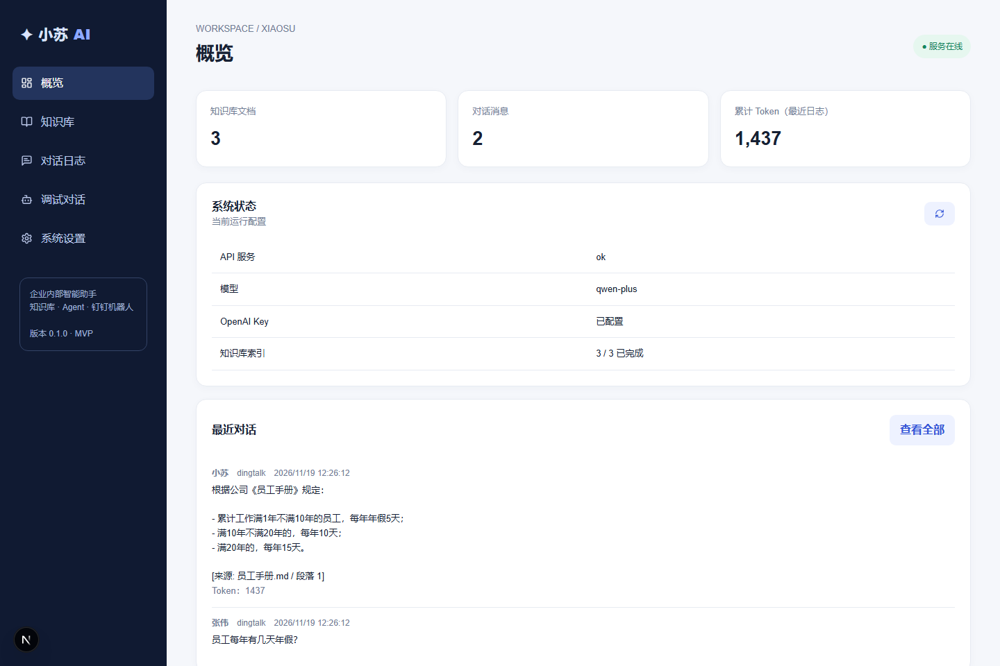
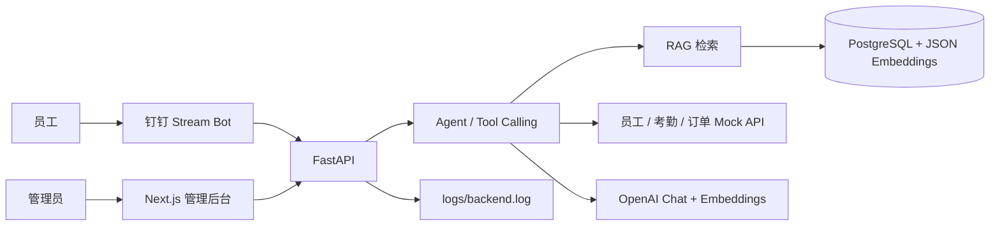

# 小苏｜企业内部 AI 助手

一个面向招聘笔试的可运行 MVP：员工通过钉钉机器人聊天，管理员通过 Web 后台维护知识库并查看对话日志。当前提供 FastAPI + Next.js + PostgreSQL/pgvector 容器化开发环境；默认通过 OpenAI 兼容协议接入阿里云百炼千问（qwen-plus + text-embedding-v4），也可切换其他兼容服务。

> **重要说明**：仓库包含演示员工、考勤和订单数据，以及虚构员工制度文档。上线前必须替换为经授权的真实数据，并补充身份认证、权限控制、审计和数据保留策略。当前后台没有管理员登录，不应直接暴露到公网。



## 功能清单

- [x] Markdown / PDF / DOCX / TXT 上传、列表、删除、同名替换和索引状态
- [x] 文档切片、OpenAI Embeddings、相似度检索、文件/段落引用
- [x] 多轮会话记忆（按 user_id + channel + external conversation id 隔离）
- [x] OpenAI Tool Calling：员工、考勤、订单、计算器、当前时间
- [x] 钉钉 Stream 机器人适配器（需开发者后台凭证）
- [x] Mock 内部 API：员工、考勤、订单查询
- [x] Web 管理后台：文档管理、对话日志、Token 统计、调试聊天、配置状态
- [x] Docker Compose、日志目录、环境变量、基础自动化测试
- [x] 模型 token 级 SSE 流式生成（支持流式 Tool Calling；Web 调试页逐 token 显示）
- [ ] 管理员登录、RBAC、文档原文定位高亮、生产级限流和完整 Evals

## 架构



当前 embedding 向量保存在 JSON 字段并由应用层计算余弦相似度：本地默认 SQLite，Docker 默认 PostgreSQL。容器数据库镜像带 pgvector，但此 MVP 尚未使用数据库原生向量索引。

## 技术栈

- 后端：Python 3.11、FastAPI、SQLAlchemy 2、Pydantic Settings、dingtalk-stream 0.24.3、uv
- 前端：Next.js 15.5（App Router）、React 19、Tailwind CSS 4、lucide-react、pnpm
- 数据：SQLite（本地默认）/ PostgreSQL（Docker）；embedding 以 JSON 存储，应用层余弦相似度
- 模型：OpenAI 兼容接口，默认 `qwen-plus` + `text-embedding-v4`
- 部署：Docker Compose；Windows 提供 PowerShell 脚本

## 环境要求

- Python 3.11+
- uv
- Node.js 22+、pnpm 9+
- Docker Compose（推荐）
- OpenAI API Key（默认使用阿里云百炼，需同时支持 Chat 与 Embeddings）
- 钉钉开放平台企业内部应用/机器人：Client ID、Client Secret，并按钉钉 Stream 模式配置机器人消息权限和事件订阅

默认 `.env.example` 已指向阿里云百炼：

```ini
OPENAI_BASE_URL=https://dashscope.aliyuncs.com/compatible-mode/v1
OPENAI_MODEL=qwen-plus
OPENAI_EMBEDDING_MODEL=text-embedding-v4
```

换其他供应商时只改这三项；RAG 需要该服务同时支持 Chat 与 Embeddings。

## 快速启动（Docker）

```bash
cp backend/.env.example backend/.env
# 编辑 backend/.env，填写 OPENAI_API_KEY、DINGTALK_CLIENT_ID、DINGTALK_CLIENT_SECRET
cp frontend/.env.example frontend/.env.local
docker compose up --build
```

访问：
- 管理后台：http://localhost:3000
- API 文档：http://localhost:8000/docs
- 健康检查：http://localhost:8000/health

## 本地启动

也可以在项目根目录用一条命令启动前后端开发服务：`./scripts/dev.sh`（首次运行会安装依赖）。

终端 1：
```bash
cp backend/.env.example backend/.env
# 设置 OPENAI_API_KEY；默认 DATABASE_URL 为 SQLite
cd backend
uv sync --group dev
uv run uvicorn app.main:app --reload --port 8000
```

终端 2：
```bash
cd frontend
cp .env.example .env.local
corepack enable
pnpm install
pnpm dev
```

### Windows

```powershell
.\scripts\dev.ps1
```

首次运行会自动复制 `.env` 模板、安装依赖，并分别打开后端和前端窗口。若提示脚本被禁止执行：

```powershell
powershell -ExecutionPolicy Bypass -File .\scripts\dev.ps1
```

只启动后端用 `.\scripts\start.ps1`，跑测试用 `.\scripts\test.ps1`。后端默认监听 `127.0.0.1:8000`，前端默认 `http://localhost:3000`。

## 钉钉机器人配置

1. 在钉钉开放平台创建企业内部应用并启用机器人能力。
2. 配置 Stream 模式的 Client ID / Client Secret，按平台当前控制台指引订阅机器人接收消息事件。
3. 将凭证写入 `backend/.env`，设置 `DINGTALK_ENABLED=true`。
4. 后端依赖安装后，在 `backend/` 目录运行：

```bash
uv run python -m app.dingtalk_bot
```

5. 将机器人加入测试群，@机器人发送问题。钉钉消息按员工 ID 和会话 ID 隔离上下文。

钉钉开放平台字段和事件权限可能随平台版本变化；请以当前控制台和官方 SDK 文档为准。Stream worker 当前作为独立容器运行（Compose 的 `dingtalk` profile），也可用进程管理器单独守护。

## 测试

```bash
./scripts/test.sh
```

测试包含计算器安全限制、Mock 员工 API、文本切片、Mock LLM 对话、钉钉处理器和系统提示日期，当前 8 条全部通过；除真实模型联调外，不需要 Key。

## 已验证

- `uv run pytest -q`：8 passed；`uv run ruff check` 通过；`pnpm build` 通过。
- 千问真实链路：文档上传/索引、制度问答与引用、员工/考勤/时间工具调用、多轮“他上周”、隐私问题拒答。
- 浏览器：调试对话展示“参考来源”标签。
- 尚未验证：钉钉真实群消息（缺少企业开发者凭证）。

## API

| 方法 | 路径 | 说明 |
|---|---|---|
| GET | `/health` | 健康检查 |
| POST | `/api/chat` | Agent 对话 |
| POST | `/api/chat/stream` | SSE 流式对话（token + meta） |
| POST | `/api/documents` | 上传并索引文档 |
| GET | `/api/documents` | 文档列表 |
| DELETE | `/api/documents/{id}` | 删除文档及切片 |
| GET | `/api/logs` | 对话日志 |
| GET | `/api/tools/logs` | 工具调用日志 |
| GET | `/api/settings` | 脱敏配置状态 |
| GET | `/api/employee/{employee_id}` | Mock 员工 API |
| GET | `/api/attendance` | Mock 考勤 API |
| GET | `/api/orders` | Mock 订单 API |

## 数据与安全

- Mock 数据在 `backend/app/tools.py`；知识库样例在 `data/knowledge/`。
- 不要提交 `.env`、API Key、真实员工隐私或生产数据。
- 示例后台未实现身份认证和权限控制，只能在本机或可信内网演示。
- 上传限制 15MB；正式环境还应加恶意文件扫描、内容脱敏、访问审计和配额限制。
- 工具调用仅访问本地 Mock 数据；接真实 API 前应加入服务端鉴权、参数校验和最小权限。

## Roadmap

1. 增加企业微信/飞书等多 IM 适配层，复用同一问答核心。
2. 将 JSON embedding 改为 pgvector 原生向量列和 HNSW/IVFFlat 索引。
3. 增加管理员登录、RBAC、操作审计、敏感字段脱敏。
4. 增加文档原文定位/段落高亮和检索评测集。
5. 增加钉钉交互卡片、文件问答、多模型供应商适配和 Langfuse。

## 文档

- 设计说明：[docs/design.md](docs/design.md)
- AI 使用说明：[AI_USAGE.md](AI_USAGE.md)
- 自评：[自评.md](自评.md)

## License

可按个人项目需求自行添加 LICENSE。样例制度和业务数据均为虚构演示内容。
